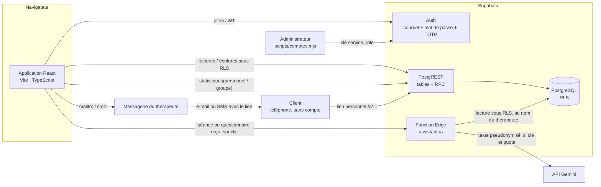
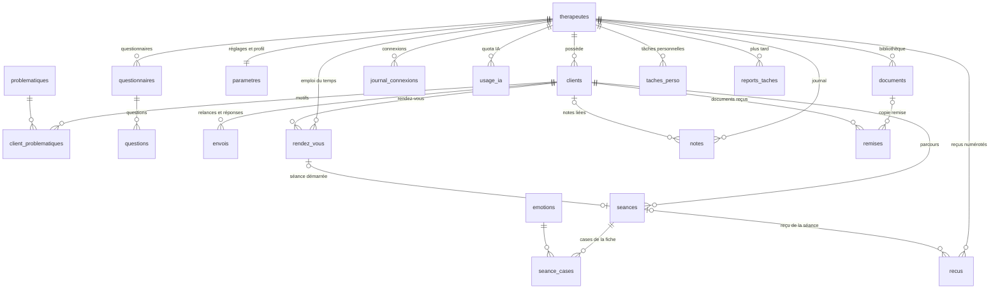

# Architecture — SaaS de suivi thérapeutique

Logiciel de suivi pour thérapeutes comportementalistes émotionnels : fiches clients
numérisées, statistiques personnelles, statistiques de groupe anonymisées, analyse IA
(Gemini, facultative), relances avec questionnaires de suivi, tâches, suivi des tarifs.
Interface 100 % en français, utilisable sur ordinateur, tablette et téléphone. Profil,
couleur, nom du site et confort de lecture (dont un mode daltonien) sont réglables par
chaque thérapeute. Ni paiement, ni agenda, ni inscription libre.

---

## 1. Vue d'ensemble



| Couche | Choix | Pourquoi |
|---|---|---|
| Interface | React 19 + Vite + TypeScript, CSS maison | Application à écrans denses (formulaires, tableaux de bord), sans framework serveur à héberger |
| Données | Supabase (PostgreSQL) | Authentification, API et **sécurité au niveau des lignes (RLS)** intégrées : la confidentialité est garantie par la base, pas par le code de l'interface |
| Statistiques | Fonction SQL `statistiques()` | Les agrégats de groupe sont calculés côté serveur. Aucune ligne brute d'un autre thérapeute ne transite jamais |
| IA | Fonction Edge Deno → Gemini `generateContent`, repli local | La clé API reste un secret du serveur, la sortie est un JSON validé, et tout fonctionne sans elle |
| Mode démo | Même interface, données fictives en `localStorage` | Maquette cliquable sans aucune installation serveur |

Les écrans ne connaissent qu'une interface, `SourceDonnees` (`src/donnees/source.ts`),
qui a deux implémentations : `demo.ts` et `supabase.ts`. La source est choisie selon la
présence des variables `VITE_SUPABASE_*`. Organisation détaillée du code et règles de
contribution : `AGENTS.md`, `src/AGENTS.md`, `supabase/AGENTS.md`.

---

## 2. Modèle de données



Migrations : `supabase/migrations/20260930120000_schema_initial.sql` (schéma, RLS,
fonctions), `20260930120100_referentiels.sql` (listes de référence) et
`20261001090000_relances_questionnaires.sql` (relances, questionnaires, paramètres de
profil et d'affichage, tarifs, journal des connexions, quota IA) et
`20261003100000_ameliorations.sql` (corbeille, accord de relance, lien actif une fois
sorti, plafond IA commun, statistiques par période) et `20261004090000_emploi_du_temps.sql`
(rendez-vous, vue `agenda`, réglages de l'emploi du temps) et
`20261005090000_journal_exercices_recus.sql` (journal, documents et remises, reçus, tâches
personnelles et reports), `20261006090000_prolongements.sql` (reçu par lien, réponses aux
exercices, tâches récurrentes) et `20261007090000_rappels_recus_groupes.sql` (rappel d'exercice,
lignes de reçu et reçus groupés).

### De la fiche papier au schéma

L'écran de séance (`src/composants/FeuilleSeance.tsx`) reprend la disposition de la
fiche papier. L'en-tête est en haut, l'Objectif au centre, et une flèche centrale monte
vers lui. Deux colonnes « Émotion Temps Présent » suivent. À gauche, le suivi croisé
Père / Mère. À droite, les rangées de 4 cases et le cadre des notes.

Chaque case de la feuille est une ligne `seance_cases (seance_id, zone, position,
emotion_id)`, remplie par un menu déroulant des 14 émotions. La structure des zones est
définie une seule fois dans `supabase/functions/_shared/fiche.ts`. La contrainte SQL la
reprend, et un test vérifie que les deux concordent.

| Fiche papier | Stockage |
|---|---|
| Nom, Prénom | `clients.nom`, `clients.prenom` |
| Âge et année | `clients.annee_naissance`. L'âge est **calculé** à la date de chaque séance |
| Date | `seances.date_seance` |
| Séance 1 ☐, Séance 2 ☐… | `seances.numero` et `seances.type` (attribués par déclencheur) |
| Père ☐ Mère ☐ | `seances.lignee` (`pere` / `mere`, une seule case cochée) |
| Objectif | `seances.objectif` (pré-rempli depuis la séance précédente) |
| T.I.M. | `seances.tim` (texte libre) |
| Émotion Temps Présent (gauche) : barre en 2 moitiés, 9 cases empilées, case du bas | zones `present1_haut` (1–2), `present1_pile` (1–9), `present1_bas` (1) |
| Émotion Temps Présent (droite) : barre en 2 moitiés, case du bas | zones `present2_haut` (1–2), `present2_bas` (1) |
| Père / Mère × Naissance, Conception, 1ère, 2ième, 3ième Génération | zones `naissance` … `generation_3`, position 1 = Père, 2 = Mère |
| 3ième Génération : 4 cases | zone `grille_generation_3` (1–4) |
| 2ième Génération : 4 cases | zone `grille_generation_2` (1–4) |
| Grand cadre (notes) | `seances.notes` |
| *(IA)* Problématique catégorisée | `seances.analyse_ia` (suggestion), puis `client_problematiques` une fois retenue |
| *(IA)* Synthèse évolutive | `clients.synthese_ia`, `clients.synthese_ia_maj_le` |

### Parcours : 3 séances, un bilan, puis des séances à l'unité

Le déclencheur `numeroter_seance` attribue le numéro et le type à la création : séances 1
à 3 → `initiale`, séance 4 → `bilan`, séances suivantes → `supplementaire`. Un verrou
consultatif sérialise les créations simultanées pour un même client. Seule la **dernière**
séance peut être supprimée (déclencheur `proteger_numerotation`), ce qui garde la
numérotation continue. Supprimer un client efface tout son parcours en cascade.

---

## 3. Confidentialité

**Fiche client strictement privée.** Chaque table clinique porte `therapeute_id`. Une
politique RLS unique, « propriétaire uniquement », s'applique à toutes les opérations.
Trois verrous la complètent :

1. **Clés étrangères composites** `(client_id, therapeute_id) → clients(id, therapeute_id)` :
   impossible de rattacher une séance ou une problématique au client d'un confrère,
   même en forgeant une requête. Idem pour les questions d'un questionnaire.
2. **Privilèges par colonne** : `numero`, `type`, `client_id` et `therapeute_id` d'une
   séance ne sont jamais modifiables. Les privilèges accordés par défaut par Supabase
   sont révoqués et ré-accordés explicitement.
3. **Aucun accès anonyme** : le rôle `anon` n'a aucun droit, ni sur les tables, ni sur
   les fonctions (sauf, par jeton : les deux fonctions du questionnaire, `document_public`,
   `repondre_document` et `recu_public`).

**Espace de groupe anonyme.** Il ne lit jamais les tables. Il appelle
`statistiques('groupe')`, une fonction `security definer` qui ne renvoie que des
agrégats, sans aucun nom ni texte libre :

- l'espace ne s'ouvre qu'à partir de **3 thérapeutes contributeurs** ;
- une case (émotion, tranche d'âge, problématique) n'est publiée que si **au moins 5
  clients d'autres thérapeutes** y contribuent. Le seuil exclut volontairement les
  clients du lecteur. Sans cela, il pourrait retrancher ses propres chiffres des
  agrégats et isoler un client d'un confrère ;
- les cases masquées passent en fin de liste, sans que leur effectif réel influe sur
  l'ordre.

Les seuils sont des constantes, à la fois dans la fonction SQL et dans
`src/config/referentiels.ts`.

**Comptes et sessions.**

| Mesure | Mise en œuvre |
|---|---|
| Création des comptes | **aucune inscription libre** : l'administrateur crée les comptes (`scripts/comptes.mjs`, clé « service_role ») ; les inscriptions sont désactivées dans Supabase Auth |
| Mots de passe | 10 caractères au moins, lettres + chiffres ou symboles ; **pas de « mot de passe oublié »** : l'administrateur fournit un mot de passe provisoire, à changer dans Paramètres > Sécurité |
| Sessions | par défaut, conservées dans l'onglet seulement (`sessionStorage`) ; option « rester connecté 8 h » (appareil personnel) qui la garde aussi dans `localStorage` avec une échéance. Le délai d'inactivité est partagé entre onglets et vérifié à la réouverture. La déconnexion ne ferme que la session de l'appareil. Les liens de connexion ou de récupération reçus par courriel sont ignorés (`detectSessionInUrl: false`) |
| Corbeille | supprimer un client le place 30 jours dans la corbeille (`supprime_le`) : il disparaît aussitôt des listes, tâches, statistiques et liens de questionnaire, reste restaurable, puis est effacé définitivement (`purger_corbeille()`, ou purge nocturne `pg_cron`) |
| Double authentification (code TOTP, application d'authentification) | Supabase Auth MFA. Une fois activée, des politiques RLS **restrictives** (`mfa_satisfaite()`) refusent toute donnée clinique tant que la session n'a pas fourni de code (niveau `aal2`). Téléphone perdu : l'administrateur retire le facteur (`npm run comptes -- retirer-2fa`) |
| Déconnexion automatique | après 30 min sans activité (réglable de 10 min à 4 h), avertissement une minute avant |
| Essais de connexion | limités par Supabase Auth ; en démo, blocage d'une minute après 5 échecs |
| Journal des connexions | date et appareil, visibles par le seul titulaire dans Paramètres > Sécurité |
| Stockage local | seulement le thème et les préférences d'affichage (aucune donnée personnelle) ; le mode démo y garde ses données fictives |
| En-têtes HTTP (`public/_headers`) | CSP stricte (aucun script tiers), `frame-ancestors 'none'`, `Referrer-Policy: no-referrer`, HSTS |

**Vérifié par les tests** (`tests/sql.test.ts`, Postgres réel via PGlite) : un autre
thérapeute ne voit, ne modifie, ne supprime et ne rattache rien (fiches, séances,
questionnaires, envois). Un visiteur anonyme n'a accès à rien (sauf les deux fonctions
du questionnaire, par jeton). Les champs structurels sont immuables. Les seuils masquent
bien les cases concernées. Avec la double authentification active, une session sans
code ne voit aucune fiche.

---

## 3 bis. Relances, questionnaires de suivi et tâches

Rien ne part automatiquement : l'application **prépare**, le thérapeute **envoie** depuis
sa propre messagerie, puis **confirme**. Aucun service d'envoi tiers ne voit les clients.

```
Dernière séance + 15 j ─► Tâche « Relancer Léa » (puis tous les 30 j, 3 fois au plus ; réglable)
  « Préparer l'e-mail » ─► choix du questionnaire (celui par défaut est proposé)
                         ─► preparer_envoi() : jeton aléatoire de 256 bits, base = empreinte SHA-256,
                            copie du questionnaire (titre, textes, questions actives)
                         ─► message rédigé depuis le modèle ({prenom}, {lien}, {signature}…)
                         ─► « Ouvrir dans ma messagerie » (mailto:) ou « dans Messages » (sms:),
                            ou « Copier » : le lien quitte l'application et devient actif (lien_sorti_le)
  « J'ai envoyé le message » ─► confirmer_envoi() : historique, lien masqué
  (fermeture sans confirmer, lien déjà sorti ─► « Le message est-il parti ? » : rien n'est supprimé d'office)
Client ─► /q/<jeton> (sans compte) ─► questionnaire_public() : questions + nom du thérapeute, rien du client
       ─► repondre_questionnaire() : valeurs contrôlées, une seule réponse, lien limité dans le temps ;
                                      confirme l'envoi si le thérapeute avait oublié de le faire
Thérapeute ─► Tâche « Questionnaire reçu de Léa », lue automatiquement (tendance, priorité)
           ─► réponses sur la fiche, courbes d'évolution
```

- **Questionnaires** : chaque thérapeute en crée autant qu'il veut (titre, introduction,
  message de remerciement) et en désigne un « par défaut », proposé à chaque relance.
  Sept types de questions : curseur (bornes et sens réglables), étoiles (3 à 10), choix
  unique, choix multiples, oui/non, émotions (les 14), texte ; chaque question peut être
  obligatoire ou facultative. Chaque envoi garde une **copie** du questionnaire : le
  modifier ne change pas les réponses passées. Les réponses sont contrôlées par
  `repondre_questionnaire` (SQL) et, à l'identique, par `validerReponses`
  (`_shared/questionnaire.ts`) dans le navigateur ; un test compare les deux cas par cas.
- **Relances** : délai après la dernière séance, intervalle, nombre maximum, validité du
  lien et modèles d'e-mail et de SMS se règlent dans Paramètres. Une nouvelle séance
  remet le compteur à zéro. Chaque relance peut être reportée d'une semaine, et chaque
  client exclu des relances. L'**accord du client** pour être recontacté se note sur sa
  fiche (`accord_relance_le`) ; une relance sans accord noté est signalée dans les Tâches.
- **Tâches** : déduites des données (`src/domaine/taches.ts`, testées). Seuls sont
  stockés les **tâches personnelles** (`taches_perso` : titre, échéance et client
  facultatifs, faite le) et les **reports « plus tard »** (`reports_taches` : clé de la
  tâche calculée → date de retour ; la clé d'une relance contient son rang, la relance
  suivante n'est donc pas masquée). Filtres par famille avec compteurs, récapitulatif de la
  semaine (`recapSemaine`), et, dans le message de relance, **créneaux libres** des deux
  prochaines semaines (`creneauxLibres` : jours et heures de travail, sans chevauchement),
  en commençant par les **habitudes du client** (`habitudesClient` : jour et heure revenus au
  moins deux fois sur l'année écoulée). **Tâches récurrentes** (`recurrence` : semaine, mois) :
  le déclencheur `tache_recurrente` crée la suivante à la première date de la série postérieure
  au jour où elle est cochée (`echeance_suivante`, 31 janvier → 28 février → 31 mars), et la
  retire si la tâche est décochée. Nouvelle tâche « Exercice complété » (clé `x-…`), et
  « Rappeler l'exercice » (clé `xr-…`) pour un exercice à compléter remis par lien, sans
  réponse ni rappel après `exercice_rappel_jours` (7 par défaut, 0 = jamais) : le rappel
  (`relancer_remise`) remplace le lien et note `rappel_le`.
  Chaque questionnaire reçu est **lu localement** (`lectureLocale`) :
  tendance par rapport au précédent (en tenant compte du sens de chaque échelle), scores
  très bas, mots de détresse dans le texte libre → priorité haute, tâche en tête de
  liste, relance suivante marquée prioritaire. L'IA ne fait que reformuler, à la demande
  (section 5).

## 3 ter. Tarifs et rentabilité (facultatifs)

> **Masqué dans l'interface depuis 0.10.3** (`ARGENT_VISIBLE = false`, `src/config/fonctions.ts`),
> comme les reçus : tout ce qui suit reste en place et se rallume d'une ligne.

Tarif par défaut (Paramètres), tarif propre à un client (fiche), et tarif de chaque
séance, pré-rempli à sa création (déclencheur `tarifer_seance`) puis modifiable. La page
Rentabilité affiche le chiffre d'affaires indicatif (période, par mois, par client), le
prix moyen et les séances sans tarif. Il n'y a aucun paiement en ligne, et le suivi se
désactive entièrement dans Paramètres.

**Reçus (notes d'honoraires).** Émis depuis une séance tarifée par `emettre_recu()` :
numéro `AAAA-NNNN` continu par thérapeute et par année (verrou consultatif, contrainte
d'unicité), un seul reçu valide par séance, date entre la séance et aujourd'hui,
coordonnées du thérapeute (nom, spécialité, adresse, téléphone, SIRET, mention de TVA)
**recopiées** au moment de l'émission. Aucun droit de modification ni de suppression :
`annuler_recu()` l'annule avec un motif, il reste dans la liste (barré) et son numéro
n'est jamais réutilisé. Pièce comptable : le reçu survit à l'effacement du client
(`client_nom` conservé, clés mises à `null`). Version à imprimer ou à enregistrer en PDF
par le navigateur (`/recus/:id`), sans bibliothèque PDF.

**Reçu envoyé par lien.** `preparer_lien_recu()` crée un jeton (empreinte seule en base,
90 jours, un nouveau lien remplace l'ancien ; refusé pour un reçu annulé ou un client à la
corbeille). Le client ouvre `/r/<jeton>` sans compte : `recu_public()` ne renvoie que ce qui
s'imprime sur le reçu (ni identifiant, ni empreinte), note la première ouverture, et montre le
tampon si le reçu a été annulé depuis. **Récapitulatif annuel** et **export CSV** calculés
dans le navigateur (`domaine/recus.ts`) : sommes au centime, annulés exclus des totaux mais
listés dans l'export ; cellules protégées (« ; », guillemets, formules de tableur neutralisées).
Le **livre des recettes** (toutes les années) ne reprend que les reçus valides, dans l'ordre
chronologique, suivis des totaux par trimestre civil et du total général.

**Reçus groupés.** Chaque reçu a ses lignes (`recus_lignes` : séance, date, prestation,
montant, ordre), créées avec lui et jamais modifiables. `emettre_recu_groupe()` émet un seul
reçu pour 2 à 31 séances tarifées d'un même client (date au plus tôt celle de la dernière
séance, numéro suivant de l'année) ; un index unique partiel garantit qu'une séance ne figure
que sur un seul reçu valide, et `annuler_recu()` annule les lignes avec le reçu.

## 3 ter bis. Emploi du temps

- **Rendez-vous** (`rendez_vous`) : type (premier rendez-vous, séance de suivi, bilan,
  administratif, personnel), statut (prévu, honoré, absent, annulé), modalité (cabinet,
  visio, téléphone, domicile), début et fin (12 h au plus), note privée. Une séance ou un
  bilan exige un client (clé étrangère composite : jamais le client d'un confrère) ; un
  créneau sans client exige un intitulé. Lecture par la vue `agenda`, qui écarte les clients
  de la corbeille. Mêmes protections que les fiches (RLS, double authentification).
- **Vues** : semaine (grille horaire, rendez-vous qui se chevauchent placés côte à côte par
  `disposer()`) et jour (liste, téléphone). Clic sur un créneau libre : nouveau rendez-vous ;
  répétition hebdomadaire ; avertissement en cas de chevauchement.
- **Lien avec le suivi** : « Commencer la séance » crée la fiche de séance du client, datée du
  jour du rendez-vous, et marque le rendez-vous honoré (`seance_id`). La catégorie proposée
  suit le parcours (aucune séance → premier rendez-vous ; 3 séances → bilan).
- **Tâches** : rappel à envoyer pour les rendez-vous des 48 h à venir (message préparé à
  partir de `modele_rappel`, envoyé depuis la messagerie, comme les relances) ; rendez-vous
  passé resté « prévu » à compléter pendant 14 jours.
- **Couleurs et daltonisme** : les couleurs d'origine (indigo, bleu, rouge brique, ocre,
  gris) ont été choisies par simulation (Machado 2009, écart OKLab) : écart ≥ 12,9 sous les
  trois daltonismes (seuil de confusion 8), ≥ 15 en vision normale, contraste ≥ 3:1. La
  couleur n'est jamais seule : pictogramme, nom du type, motif (barre double pour un premier
  rendez-vous, barre épaisse pour un bilan, pointillés pour l'administratif, hachures pour le
  personnel), statut par pictogramme, annulé barré. Les couleurs choisies par le thérapeute
  sont vérifiées en direct (`domaine/couleurs.ts`) et l'aperçu peut être simulé tel que le
  voit une personne protanope, deutéranope ou tritanope (filtre SVG, mêmes matrices).

## 3 ter ter. Journal, exercices et documents, activité

> **Exercices et documents masqués dans l'interface depuis 0.10.3** (`EXERCICES_VISIBLES =
> false`, `src/config/fonctions.ts`) ; le journal et l'activité restent affichés.

- **Journal** (`notes`) : notes privées, libres ou liées à un client (clé composite),
  épinglables ; vue `journal` sans les clients de la corbeille. Même protection que les
  fiches (RLS, double authentification).
- **Exercices et documents** (`documents`) : bibliothèque personnelle en texte simple
  (« # » intertitre, « - » liste), affichée sans jamais interpréter de HTML
  (`domaine/texte.ts`). **Remise** (`remises`) par `preparer_remise()` : copie figée du titre
  et du texte ; par lien personnel (jeton 256 bits, empreinte seule, 90 jours) ou sur papier.
  Le client ouvre `/d/<jeton>` sans compte : `document_public()` ne renvoie que le document
  et le nom du thérapeute, note la première ouverture, et ne montre rien si le lien a
  expiré ou si le client est à la corbeille. Retirer une remise désactive le lien.
- **Exercice à compléter** : les lignes « ? » d'un document sont des questions
  (`questions_document`, miroir exact de `questionsDocument`, comparés par un test). Le client
  répond depuis son lien : `repondre_document()` recopie les questions **de la copie remise**
  (le client n'envoie que ses réponses), 5 000 caractères au plus par réponse, au moins une
  réponse, une seule fois. Les réponses (`remises.reponses`) ne sont lisibles que par le
  thérapeute ; les ouvrir renseigne `consulte_le` (seule colonne modifiable) et retire la tâche.
  Sur la fiche de séance, les exercices rendus depuis la séance précédente s'affichent en tête
  (`domaine/exercices.ts`) et comptent comme lus.
- **Activité** : calcul pur (`domaine/activite.ts`) sur les rendez-vous de l'espace
  personnel — heures de consultation par semaine, rendez-vous tenus, taux d'absence
  (rendez-vous passés) et d'annulation, répartition par type et modalité, carte
  jour × heure des créneaux demandés (nombre écrit dans chaque case, rampe d'une seule
  teinte). Rien n'est partagé avec l'espace de groupe.

## 3 quater. Profil, affichage, accessibilité, tablette

- **Style** : système de design **Flow** de l'utilisateur, avec le violet comme seul accent
  (fond beige, cartes blanches, menu sur le fond, un seul bandeau sombre par écran). Règles
  et correspondance des variables : `docs/DESIGN.md`. Mise en ligne de la démonstration
  (GitHub Pages, sous-dossier) : `docs/DEPLOIEMENT.md`.
- **Profil** : photo (réduite à 160 px dans le navigateur, 300 Ko au plus), spécialité,
  téléphone, signature des messages (variable `{signature}`).
- Chaque thérapeute choisit le **nom du site** et la **couleur principale**. Toutes les
  nuances dérivent d'une seule variable CSS (`--marque`, via `color-mix`). Une couleur
  trop claire est refusée (contraste du texte des boutons sous 4,5:1).
- **Mode daltonien** : palettes d'état rouge-vert (bleu / ocre / framboise) et bleu-jaune
  (sarcelle / prune / rouge), vérifiées par simulation de la vision des couleurs (la
  palette standard vert / orange / rouge se confond en vision rouge-verte). Tout état
  porte aussi un pictogramme et un libellé.
- **Confort** : taille du texte (3 niveaux), densité compacte, réduction des animations,
  page d'ouverture après connexion. Ce sont des attributs `data-*` sur `<html>`, lus par
  `src/styles/accessibilite.css`.
- **Impression** : menus, boutons et boîtes de dialogue sont masqués.
- **Tactile** : sur écran tactile, cibles d'au moins 44 px et texte de 16 px dans les
  champs (pas de zoom automatique sur iPad ou iPhone). Les menus déroulants restent
  natifs, donc adaptés au toucher.
- **Tablette** : la fiche papier garde sa disposition en deux colonnes jusqu'à 560 px de
  large ; en dessous, elle s'empile.

---

## 4. Statistiques

Une seule fonction SQL sert les deux espaces, avec les mêmes définitions :

| Indicateur | Définition |
|---|---|
| Apparition d'une émotion | part des séances où elle figure dans une case « Émotion Temps Présent », et apparitions ÷ clients |
| Émotions par tranche d'âge | même calcul, restreint aux séances de la tranche (âge au moment de la séance) |
| Problématiques fréquentes | part des clients suivis ayant cette problématique **retenue** |
| Séances par client | séances ÷ clients ayant au moins une séance |
| Durée moyenne de suivi | moyenne, par client, de (dernière séance − première séance) |
| Parcours jusqu'au bilan | part des clients ayant atteint la 4e séance |
| Séances par mois | nombre de séances de chacun des 12 derniers mois |

Le mode démo recalcule ces chiffres en TypeScript (`src/domaine/statistiques.ts`). Un
test charge le même jeu de données dans Postgres et exige des résultats **identiques** à
ceux de la fonction SQL.

Le tableau de bord personnel peut se limiter aux **3 ou 12 derniers mois** (le mois en
cours et les précédents ; la courbe mensuelle garde ses 12 mois). L'espace de groupe
porte toujours sur tout l'historique : autoriser des fenêtres de dates au choix
permettrait, par différence entre deux périodes, d'isoler les séances d'un seul client
d'un confrère. Les clients de la corbeille ne sont comptés nulle part.

---

## 5. Intelligence artificielle (Gemini)

```
Thérapeute ─ « Analyser » (séance) ou « Lecture IA » (questionnaire reçu)
           ─► Fonction Edge assistant-ia (jeton du thérapeute → RLS)
                 1. lit la séance (ou le questionnaire et le précédent du même client)
                 2. calcule la version locale (analyseSimulee / lectureLocale)
                 3. réserve une unité de quota (consommer_quota_ia) ; sinon → version locale
                 4. pseudonymise : nom et prénom retirés du texte (casse et accents ignorés)
                 5. Gemini generateContent, sortie JSON imposée
                 6. valide la réponse ; en cas d'erreur → version locale
                 7. ré-injecte le prénom, enregistre dans la fiche privée
```

- **Catégorisation** : 1 à 3 problématiques parmi le référentiel, avec confiance et
  justification. Elles restent des **suggestions** : le thérapeute clique « Retenir »
  pour les ajouter à la fiche, et seules les problématiques retenues alimentent les
  statistiques.
- **Synthèse évolutive** : chaque analyse part de la synthèse de la *dernière séance
  antérieure analysée*. Relancer l'analyse d'une séance ne l'intègre donc jamais deux
  fois. La fiche client affiche la synthèse de la séance analysée la plus avancée.
- **Lecture d'un questionnaire** (onglet Tâches) : Gemini reformule le résumé et la
  suggestion ; la priorité et les faits marquants restent ceux de la lecture locale. Le
  résultat est conservé (`envois.analyse_ia`) pour ne pas rappeler Gemini.
- **Sobriété** : une seule clé pour toute la plateforme. Aucun appel automatique,
  seulement sur clic ; quota quotidien par thérapeute (`ia_quota_jour`, 20 par défaut,
  200 au plus) et **plafond commun** à toute la plateforme (table `plateforme`, 300 par
  défaut, réglé par l'administrateur ; réservations sérialisées par un verrou).
- **Accès** : la fonction n'accepte que les adresses du site (`ORIGINE_AUTORISEE`) ; sans
  ce réglage, seulement le développement local.
- **Sans Gemini** (pas de clé, quota atteint, panne) : la version locale est renvoyée ;
  l'utilisateur n'est jamais bloqué.
- **Consignes** : aucun diagnostic, aucune invention, pas de nom, français professionnel.
- **Modèle** : `gemini-3.8-flash` par défaut, réglable par le secret `GEMINI_MODEL`.
- **Journaux** : seul le statut HTTP est journalisé, jamais le contenu clinique.
- Le code de préparation et de validation (`supabase/functions/_shared/analyse.ts` et
  `questionnaire.ts`) est partagé par la fonction Edge, le mode démo et les tests.

---

## 6. Conformité : points à traiter avant la mise en production

Ce qui suit est une liste de vigilance technique, pas un avis juridique. À valider avec
un juriste ou un DPO.

- **Données de santé.** Les éléments émotionnels et psychologiques recueillis pour un
  accompagnement relèvent très probablement de l'article 9 du RGPD. En France,
  héberger des données de santé pour le compte de tiers exige un hébergeur certifié
  **HDS**. Il faut vérifier la certification de l'offre Supabase retenue. À défaut,
  Supabase est un logiciel libre qui peut être auto-hébergé chez un hébergeur certifié
  HDS : l'application n'a rien à changer.
- **Gemini.** Utiliser l'offre **payante** de l'API. Les conditions de l'offre gratuite
  autorisent Google à exploiter les contenus pour améliorer ses produits. Il faut aussi
  encadrer le transfert (accord de sous-traitance, localisation) et informer les
  clients. La pseudonymisation retire nom et prénom, mais pas les autres éléments
  identifiants qu'un thérapeute pourrait écrire dans ses notes.
- **Analyse d'impact (AIPD)** : très probablement requise (données sensibles, IA).
- **Relances** : recueillir l'accord du client pour être recontacté par e-mail ou SMS
  (le réglage « Relancer ce client » permet de respecter un refus). Les réponses au
  questionnaire sont elles aussi des données de santé.
- **À développer** : export complet d'une fiche (droit d'accès et portabilité), durée
  de conservation et purge, sauvegardes chiffrées (voir `docs/IDEES.md`).

---

## 7. Hypothèses à confirmer

| Sujet | Hypothèse retenue | Où la changer |
|---|---|---|
| Les 14 émotions clés | Liste **provisoire** (Peur, Colère, Tristesse, Joie, Culpabilité, Honte, Abandon, Rejet, Injustice, Trahison, Humiliation, Impuissance, Dévalorisation, Solitude) | `src/config/referentiels.ts` + nouvelle migration (conserver les identifiants 1–14) |
| Contenu d'une case | une émotion (menu déroulant des 14) | `_shared/fiche.ts` + contrainte de `seance_cases` |
| Cases « Séance 1 / Séance 2 » du papier | une fiche numérique par séance, numéro attribué automatiquement ; les deux colonnes « Émotion Temps Présent » sont disponibles à chaque séance | `FeuilleSeance.tsx` |
| Barre en deux moitiés | deux émotions côte à côte (sens des moitiés non interprété) | `_shared/fiche.ts` |
| T.I.M. | champ texte libre, sens non interprété | — |
| « Moyenne d'apparition » | part des séances où l'émotion figure, et apparitions par client | fonction `statistiques()` + `statistiques.ts` |
| Émotions comptées dans les statistiques | toutes les cases « Émotion Temps Présent » (pas le suivi croisé ni les grilles de générations) | idem |
| Père / Mère | une seule case cochée à la fois | `FeuilleSeance.tsx` |
| Lignée, Objectif | saisis à chaque séance, pré-remplis depuis la précédente | `creerSeance` |
| Tranches d'âge | < 12, 12–17, 18–25, 26–35, 36–45, 46–55, 56–65, 66 + | `TRANCHES_AGE` + migration |
| Seuils d'anonymat | 3 thérapeutes, 5 clients d'autres thérapeutes par case | constantes SQL + `referentiels.ts` |
| Paramètres | chacun règle tout pour son seul espace ; seul l'administrateur gère les comptes | table `parametres`, `scripts/comptes.mjs` |
| Relance | après la dernière séance : 15 j, puis tous les 30 j, 3 fois au plus | Paramètres > Relances |
| Envois | à la main, depuis la messagerie du thérapeute (aucun envoi automatique) | `DialogueEnvoi.tsx` |
| Une relance envoyée | compte comme relance, même si le client a répondu | `src/domaine/taches.ts` |
| Questionnaire | 7 types de questions, plusieurs questionnaires, un « par défaut » | Paramètres > Questionnaires |
| Priorité d'un questionnaire reçu | dégradation moyenne ≥ 8 %, baisse ≥ 30 % sur une question, score ≤ 20 %, ou mots de détresse | `lectureLocale` (`_shared/questionnaire.ts`) |
| Quota IA | 20 appels Gemini par jour et par thérapeute (0 à 200) ; 300 par jour pour toute la plateforme | Paramètres > Assistant IA ; `npm run comptes -- quota-ia` |
| Corbeille | 30 jours avant l'effacement définitif | `purger_corbeille()` + `CORBEILLE_MS` (démo) |
| « Rester connecté » | 8 heures après la connexion | `DUREE_MEMOIRE_MS` (`memoireSession.ts`) |
| Emploi du temps | 8 h – 20 h, du lundi au vendredi, rendez-vous de 60 min ; rappel proposé 48 h avant ; rendez-vous passé à compléter pendant 14 jours | Paramètres > Emploi du temps ; `domaine/taches.ts` |
| Tarifs | facultatifs, par séance (défaut → client → séance) ; aucun suivi des paiements | Paramètres > Tarifs |
